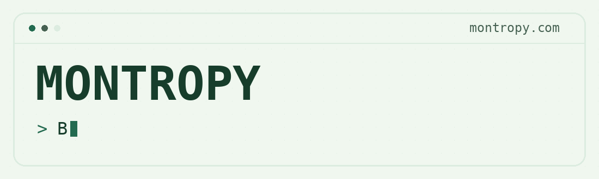

  <a href="https://montropy.com">
    <picture>
      <source media="(prefers-reduced-motion: reduce)" srcset="assets/banner-still.png">
      <source media="(prefers-color-scheme: dark)" srcset="assets/banner-dark.gif">
      
    </picture>
  </a>
    
  

## Hey, I'm Monty

I'm a software developer who builds websites and futzes around with AI. Lately I've been doing a lot of coding with Claude.

I keep coming back to apps I wish I had. Some start with a problem I run into myself, others start with a question.

## 🧰 What I'm tinkering with

`Claude Code` · `Local AI models` · `Astro` · `Cloudflare`

I use Claude when I'm coding and use Astro and Cloudflare for web projects.
